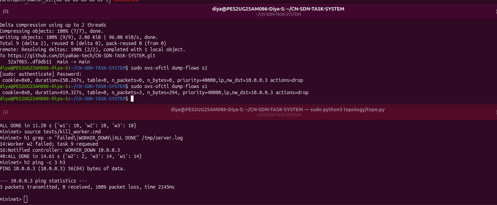

# Distributed Task Notification and Worker System: Report

Computer Networks (UE25CS243A), Mini-project 29, PES University

Team:
- Diya N Rao, PES2UG25AM086
- Galina Kathleen G, PES2UG25AM093
- Dakshitha Pechetti, PES2UG25AM074

## 1. Abstract

A central server hands out numbered tasks to several workers over TCP and collects the results. Workers pull the next task when they are free, so faster workers automatically do more work. If a worker dies or is silent for 5 seconds, the server puts its task back in the queue and reports the failure to an SDN controller (POX). The controller installs a drop rule on the Open vSwitch switch so that no traffic reaches the failed worker. When the worker returns, the server reports it up and the controller removes the rule. The whole system runs in a Mininet network on one machine.

## 2. Objectives

1. Distribute tasks to workers over reliable TCP connections.
2. Balance load: faster workers take more tasks.
3. Detect failed or slow workers within 5 seconds and re-queue their tasks so no work is lost.
4. Let the SDN controller change the network at run time, using events sent by the server.
5. Measure completion time and compare it with a static equal-split baseline.

## 3. Topology

One Open vSwitch switch (s1) with four hosts, controlled by a remote POX controller (c0).

| Device | Role | IP address |
| --- | --- | --- |
| h1 | Task server | 10.0.0.1 |
| h2 | Worker w1 | 10.0.0.2 |
| h3 | Worker w2 | 10.0.0.3 |
| h4 | Worker w3 | 10.0.0.4 |
| root node | Controller-side interface (reaches POX) | 10.0.0.100 |
| c0 | POX controller | 127.0.0.1 (port 6633) |

Ports used:

| Port | Used for |
| --- | --- |
| 5000 | Tasks and results, server to workers (TCP) |
| 6633 | OpenFlow 1.0, switch s1 to the controller |
| 9999 | Server events (WORKER_UP, WORKER_DOWN) to the controller (TCP) |

Messages are JSON, one per line: REGISTER, TASK, RESULT and DONE.

## 4. Configuration

Environment: VirtualBox VM, Ubuntu 25.04, Python 3, Mininet, Open vSwitch, POX 0.7.0.

Key settings:

- Switch protocol: OpenFlow 1.0
- Task timeout: 5 seconds (socket timeout on the server)
- Drop rule: priority 40000, match IPv4 with destination equal to the worker IP, no actions (drop)
- Number of tasks: 30; each worker sleeps 1 s per task (3 s for the slow worker)

How to run:

1. Terminal 1: `cd ~/pox` then `python3 -u pox.py log.level --DEBUG forwarding.l2_learning task_controller`
2. Terminal 2: `sudo mn -c`, then `cd ~/CN-SDN-TASK-SYSTEM`, then `sudo python3 topology/topo.py`
3. In the Mininet prompt: `source tests/normal.cmd`
4. Terminal 3: `sudo ovs-ofctl dump-flows s1`

Files: server/server.py, worker/worker.py, controller/task_controller.py, topology/topo.py, tests/*.cmd, baseline/static_server.py.

## 5. Test cases and results

| No. | Test | Setup | Expected | Actual | Comment |
| --- | --- | --- | --- | --- | --- |
| 1 | Network up | Start Mininet, run pingall | All hosts reach each other | 0% dropped, 12 of 12 pings | Network works before the system starts |
| 2 | Switch connected | ovs-vsctl show | Controller 127.0.0.1:6633, connected | is_connected: true | s1 is controlled by POX |
| 3 | Tasks over TCP | Server on h1, workers on h2 to h4 | Workers receive tasks and return results | Each worker printed Got task and Sent result | TCP part works |
| 4 | Normal run | 3 workers, 1 s per task, 30 tasks | About 10 s, even split | 11.20 s, split 10 / 10 / 10 | Controller received WORKER_UP for each worker |
| 5 | Worker failure | Kill w2 after 3 s | All tasks still finish | 14.61 s, w2 did 2 tasks, others did 14 each; task 9 re-queued | WORKER_DOWN sent, BLOCK installed |
| 6 | Drop rule | dump-flows twice, then h2 pings h3 | Rule present, packets dropped | priority=40000, nw_dst=10.0.0.3, actions=drop; counter 0 to 3; 100% ping loss | Application changed the network |
| 7 | Slow worker | w3 takes 3 s per task | Load moves to fast workers | 15.02 s, split 13 / 12 / 5 | Pull-based queue balances load |
| 8 | Static baseline | Same slow worker, tasks split equally in advance | About 30 s | 30.94 s, split 10 / 10 / 10 | About twice as slow as test 7 (15.02 s) |

Screenshots:

### Comments

- Load balancing needs no scheduler. Workers ask for the next task only when free, so a slow worker gets fewer tasks.
- The failure test shows no task is lost: the dead worker's task goes back in the queue.
- The static baseline shows how much the pull-based design gains: with the same slow worker (3 s per task), an equal split of 10 tasks each took 30.94 s because the slow worker was the bottleneck, while our pull-based design finished in 15.02 s, about half the time (2.06 times faster).

## 6. Limitations and future work

- A blocked worker cannot rejoin until the server sends WORKER_UP. Fix: re-admission, or a rule that expires.
- The event messages travel through s1, so a rule that dropped traffic to 10.0.0.100 would stop them.
- UDP was not implemented; TCP was chosen so tasks and results are never lost or reordered.
